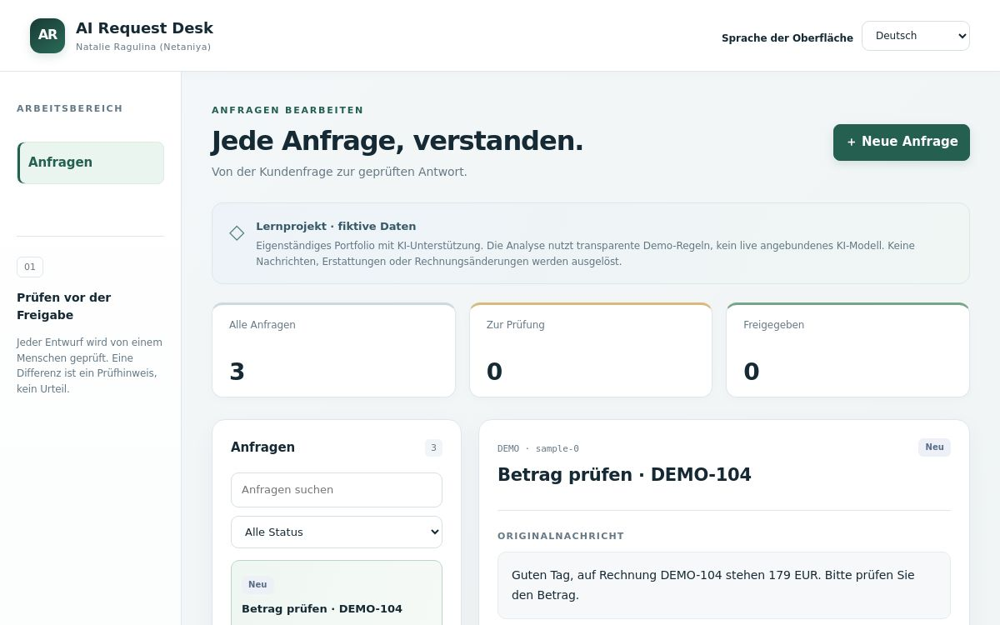
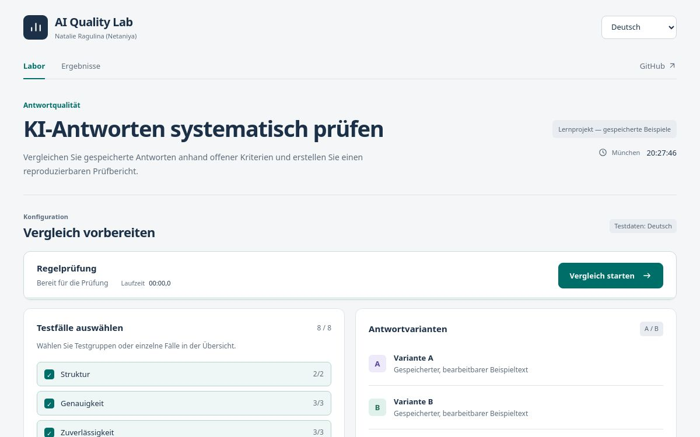

# Natalie Ragulina (Netaniya)

 

**Webentwicklung · KI-Integration · Automatisierung**  
München, Deutschland · [English](README.en.md) · [Русский](PORTFOLIO.ru.md)

Ich entwickle Webanwendungen und arbeite mit Python, JavaScript/TypeScript, APIs und automatisierten Tests. Meine praktische Erfahrung stammt aus eigenen Softwareprojekten und selbstständiger Weiterbildung. Ich nutze KI-Coding-Assistenten und übernehme Anforderungen, Architekturentscheidungen, Code-Review, Fehlersuche und die Prüfung des tatsächlichen Ergebnisses.

## Projekte

### AI Request Desk
Anfragen bearbeiten, Rechnungsdaten vergleichen und Antwortentwürfe vor der Freigabe prüfen.

- Rechnungsabgleich, bearbeitbare Entwürfe, Statusverlauf, Fehlerbehandlung und browserlokale Speicherung.
- **JavaScript · HTML · CSS** · vier UI-Sprachen · **25 automatische Prüfungen**.
- Lernprojekt mit fiktiven Daten und transparenten Regeln; die veröffentlichte Demo verwendet kein Live-LLM.

**[Live-Demo ohne Anmeldung](https://netaniya.github.io/Netaniya/ai-request-desk) · [Code & Dokumentation](portfolio/ai-request-desk/README.md)**

### AI Quality Lab
Gespeicherte Antworten anhand offener Kriterien vergleichen und Ergebnisse reproduzierbar exportieren.

- Acht Testfälle, bearbeitbare Varianten, gewichtete Scores und nachvollziehbare Einzelprüfungen.
- **JavaScript im Browser · HTML · CSS · Python-Evaluator** · vier UI-Sprachen · **32 automatische Prüfungen**.
- Zusätzlich: **[React-/TypeScript-Client mit FastAPI-Backend](portfolio/ai-quality-lab/fullstack/README.md)**, lokal ausführbar, mit optionalem serverseitigem Responses-API-Adapter. **17 Backend- und 8 Client-Tests** bestanden; ein echter Modellaufruf ist noch nicht verifiziert.
- Die öffentliche GitHub-Pages-Demo prüft gespeicherte Beispiele lokal im Browser und benötigt keinen API-Schlüssel. Die Worker-Variante bleibt im Quellcode erhalten.

**[Live-Demo ohne Anmeldung](https://netaniya.github.io/Netaniya/ai-quality-lab) · [Code & Dokumentation](portfolio/ai-quality-lab/README.md)**

### Motion Atelier
Mehrseitige Automotive-Lernanwendung mit echten Fotografien von Tesla Model S, Model Y und Cybertruck sowie illustrativen Konfigurationsdaten.

Foto: Mr.choppers · CC BY-SA 3.0 · [Original und Bildnachweise](portfolio/motion-atelier/dist/assets/photo-credits.json).

- **10 HTML-Seiten · vier Sprachen · 59 automatische Prüfungen** · kurzer, überspringbarer Realfilm eines fahrenden Autos, Manrope und mittige Titel.
- Unveränderte Originalfotos; Räder und Interieur erscheinen in der Auswahl und Zusammenfassung. Keine Lackauswahl.
- Sanfte Seitenwechsel, einmalige Scroll-Einblendungen, mobiles Menü, Vergleichsleiste, gemerkte Konfiguration und Intro-Musik mit Ausschalter und Browser-Fallback.
- Finder, Konfigurator mit Preisberechnung, teilbare Links, lokale Garage und Energieplanung.
- Interaktive Leaflet-/OpenStreetMap-Karte mit OSRM-Straßenrouten und Open-Meteo-Wetter auf Anfrage; Schätzungen und fiktive Fahrzeugdaten sind gekennzeichnet.
- **JavaScript-ES-Module · HTML · CSS**. Noch keine abschließende mobile oder Desktop-Sichtprüfung der veröffentlichten Version.

**[Live-Demo ohne Anmeldung](https://netaniya.github.io/Netaniya/motion-atelier) · [Code & Dokumentation](portfolio/motion-atelier/README.md)**

### N25x

Einen humanoiden 3D-Roboter gestalten, Mathematik mit 48 Aufgabentypen üben, zehn Einstiegssprachkurse und 20 Programmiermissionen bearbeiten. Klavier mit mehrspuriger Aufnahme, Notenbearbeitung und MIDI/WAV-Export, eigene Quizspiele, vier Oberflächensprachen und lokale Profile. Installierbare Web-App mit autonomer HTML-Kopie. **Schöpferin, Idee und künstlerische Leitung: Natalie Ragulina.** Entwicklung mit KI-Unterstützung. **© 2026 Natalie Ragulina. All rights reserved.**

[N25x öffnen](https://netaniya.github.io/Netaniya/eliana-n25x/workshop/) · [Code & Dokumentation](portfolio/eliana-n25x/README.md)

### Neta25X · früher Interface-Prototyp
[Responsive Benutzeroberfläche mit eigener visueller Identität](https://github.com/Netaniya/Neta25X), HTML, TailwindCSS und JavaScript. Meine neueren Full-stack- und KI-Projekte befinden sich in privater Entwicklung.

## Technische Kenntnisse

- **Sprachen:** Python, JavaScript, TypeScript, HTML, CSS.
- **Web & API:** FastAPI, React, Next.js, API-Integration.
- **Entwicklungsprozess:** Git/GitHub, Docker, automatisierte Tests, CI, Code-Review und Debugging.
- **KI & Automatisierung:** Codex, KI-Coding-Agenten, n8n, Flowise; Arbeitskenntnisse in MCP, RAG und Agenten-Workflows.
- **Qualität:** Modellantworten bewerten, Integrationsfehler und GPU-Inferenzprobleme untersuchen.

Die Technologien sind projektübergreifend angegeben; die jeweilige Projektbeschreibung nennt die tatsächlich veröffentlichte Implementierung. Die vier aktuellen Portfolio-Projekte wurden gemeinsam mit KI-Unterstützung entwickelt. Mein konkreter Beitrag ist bei jedem Projekt beschrieben.

## Arbeitsweise

Ein grüner Testlauf und ein korrektes Ergebnis sind zwei Prüfungen. Ich kontrolliere das tatsächliche Verhalten und untersuche Abweichungen in Code, Daten, Abhängigkeiten, Integrationen und Modellausgaben.

## Weiterbildung

HarvardX / edX – CS50's Introduction to Artificial Intelligence with Python · Coursera – Hands-on Agentic AI: Building Intelligent Agents · Universität Helsinki / MinnaLearn – Elements of AI · TEL-RAN – Digital Web Marketing & Business.

**Kontakt:** [netaniya3@gmail.com](mailto:netaniya3@gmail.com)

