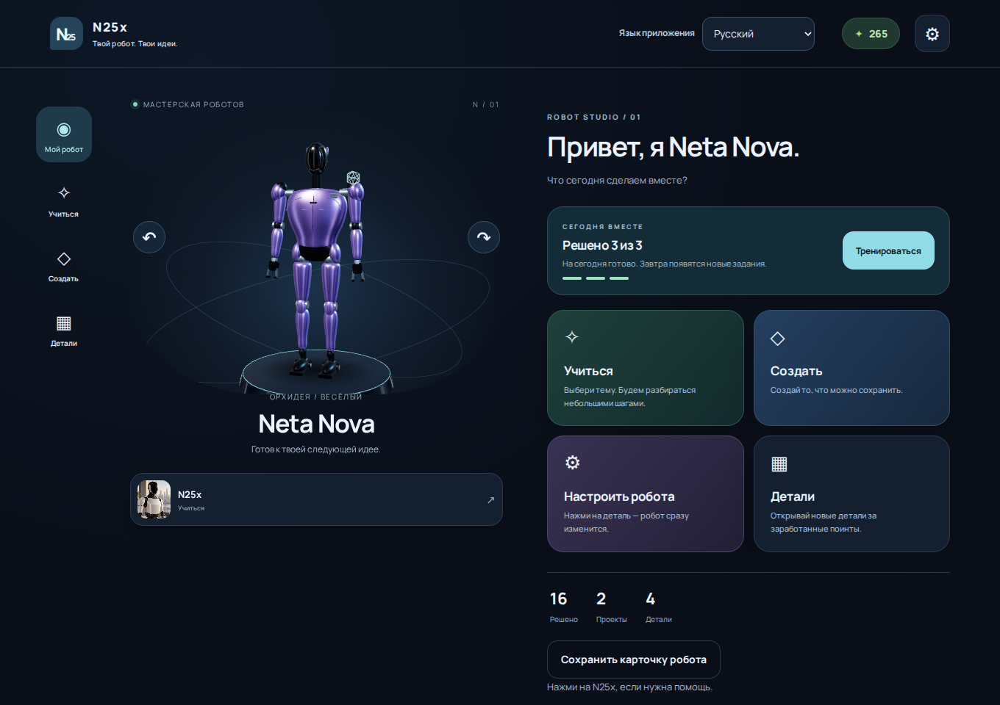
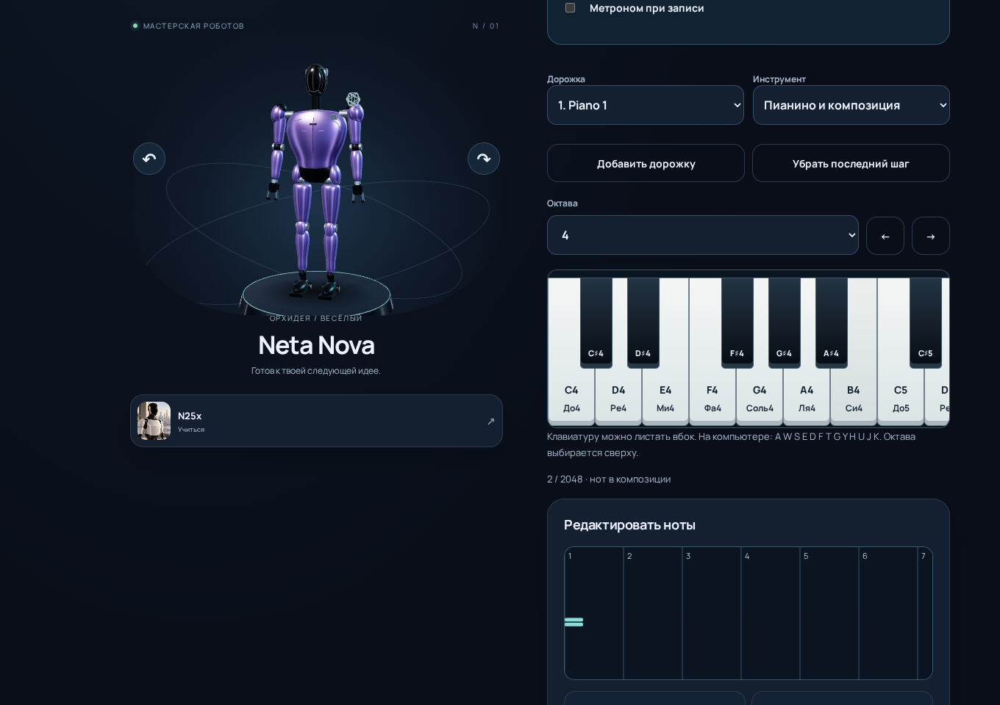
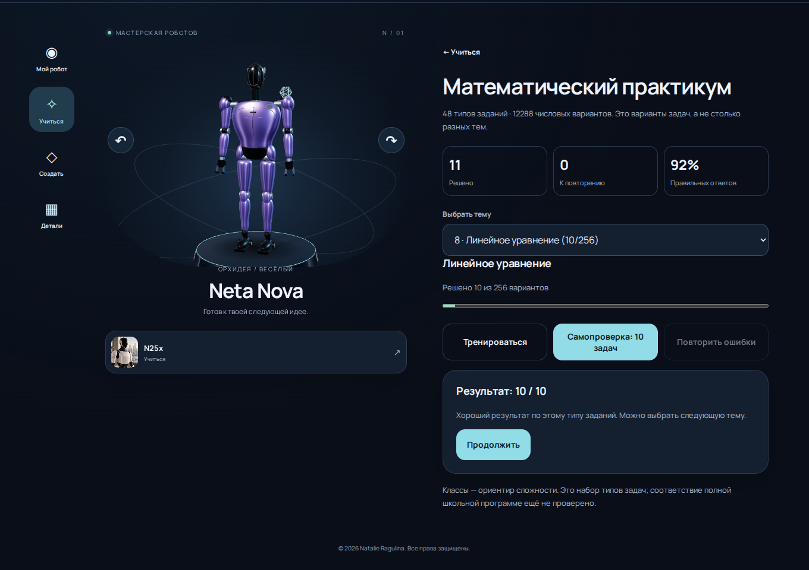
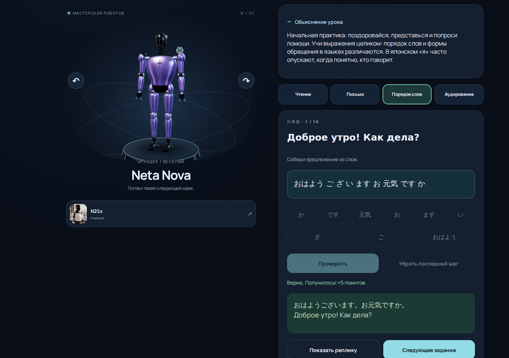
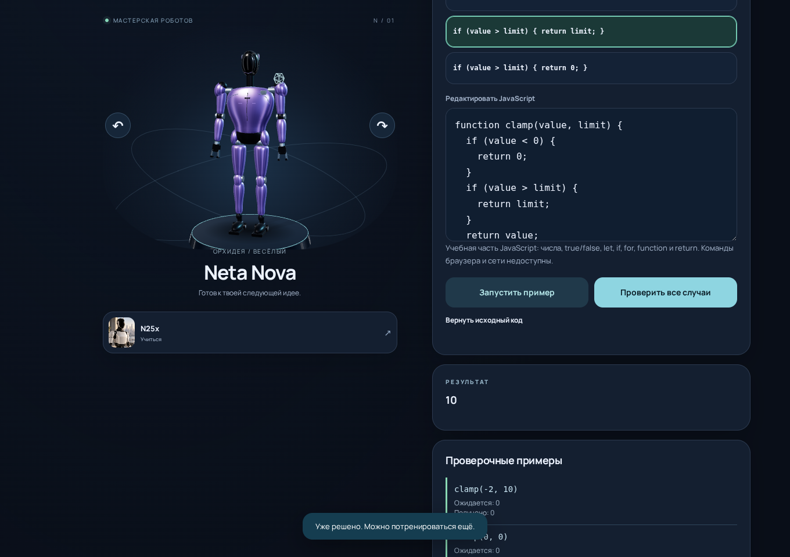
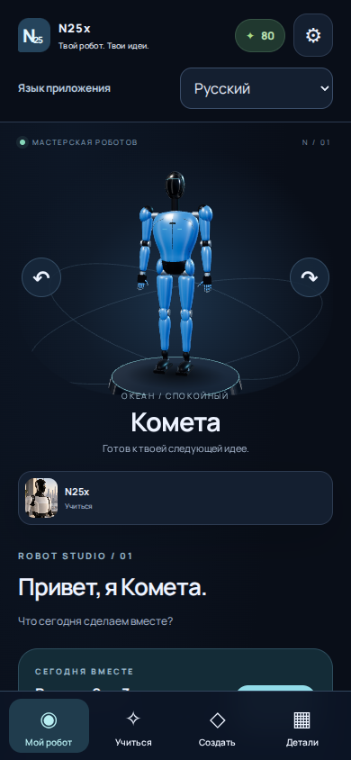
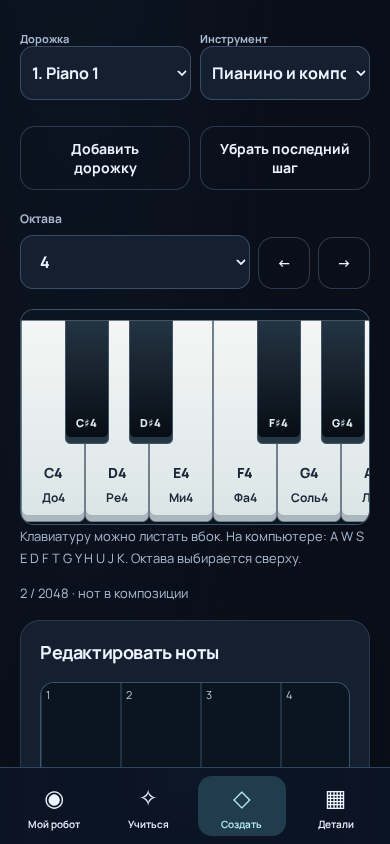
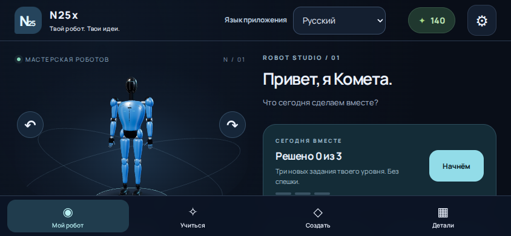
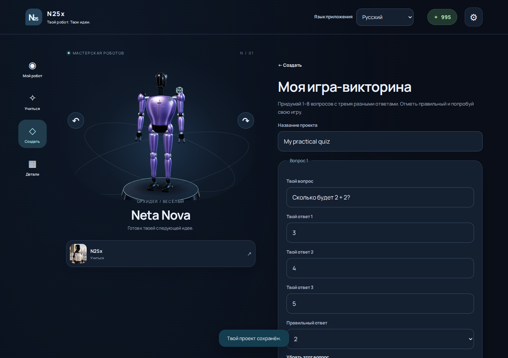

# N25x — приложение и результаты проверки

**Создатель, автор идеи, концепции и художественного направления — Natalie Ragulina.**

**© 2026 Natalie Ragulina. All rights reserved.**
**© 2026 Natalie Ragulina. Все права защищены.** Разработка и подготовка материалов с помощью ИИ.

[Открыть N25x](https://netaniya.github.io/Netaniya/eliana-n25x/workshop/) · [Инструкция и установка](../../portfolio/eliana-n25x/README.ru.md) · [Chromium Actions](https://github.com/Netaniya/Netaniya/actions/runs/38979855746)

Проверенный кандидат: `00c6f973c9abd1085c21e9ba2136d2acb2fb3f7d`, сборка `en25xstudio-fbcb0a052494e4`. Снимки ниже получены из настоящего интерфейса Chromium после автоматизированного управления мышью, клавиатурой и касаниями. Диагностическая строка скрыта только при съёмке. Имя и портрет Eliana удалены из текущего приложения; прежние игры сохранены по отдельным адресам.

## Что можно попробовать

1. Настроить гуманоидного робота, выбрать материал и цвет, получить поинты за практику.
2. Открыть «Учиться → Математический практикум»: 48 типов задач и 12 288 параметрических вариантов, объяснения, решения, повторение ошибок, самопроверка на 10 задач и сохранённый прогресс. Варианты чисел учитываются отдельно от числа тем.
3. Выбрать языковой курс: 10 языков, 12 тем, по 120 смысловых реплик на язык. Чтение, письмо и порядок слов дают по 360 форм упражнения на язык; исходных переводных текстов всего 1 200. Аудирование зависит от установленных локальных голосов устройства.
4. Пройти 20 миссий программирования: прогнозировать, исправлять и выполнять ограниченный JavaScript с 95 проверочными входами.
5. Открыть «Создать → Пианино и композиция»: именованные клавиши A0–C8, аккорды, запись, до четырёх партий и 64 тактов, редактирование нот, отмена, сохранение и настоящий MIDI/WAV/JSON.

Полный языковой маршрут до C1 ещё не реализован. Переводы подготовлены с ИИ-помощью и пока не проверены носителями и преподавателями. Математика не заявляется полной национальной школьной программой. Музыкальные инструменты синтезированы локально; акустические сэмплы не используются. Подробное [наполнение и план](../../portfolio/eliana-n25x/workshop/LEARNING-PLAN.ru.md) отделяют существующие функции от будущих.

## Что действительно проверено

- Автоматически: 88 тестов проекта — 46 прежних игр, 16 основ Studio, 17 практики и 9 расширенного обучения/музыки; ещё 12 проверок общей сборки портфолио. Один тест перебирает все математические варианты; это не 12 288 отдельных тестов.
- Chromium на компьютере: **22 сценария**. WebGL-робот, настройки, поинты, практика, проекты, экспорт/импорт, звук, четыре языка, новые курсы и пианино.
- Chromium с эмуляцией телефона: **14 сценариев**. Настоящие события касания, в том числе два одновременных контакта для аккорда; экраны 390×844, 844×390 и 320×740. Математические кнопки проверены на отсутствие переполнения текста в четырёх языках при ширине 320 px.
- На обеих конфигурациях выполнены все 20 учебных программ, чтение/письмо на десяти языках, порядок слов на английском, грузинском, китайском и японском, математическая самопроверка, запись и редактирование партитуры, реальные загрузки MIDI/WAV/JSON и восстановление после перезагрузки.
- Видимый переключатель DE/EN/RU/UK переводит активные экраны и авторскую подпись без потери поинтов. При первом посещении — немецкий.
- Скачанный HTML действительно открывается из локального файла в отключённом от сети Chromium, рендерит робота и выполняет практическое задание. Отдельно прошла холодная офлайн-перезагрузка веб-приложения с 30 ресурсами, курсами, партитурой, проектами и балансом.
- Старые ключи `eliana-n25x.save.v1` и `eliana-n25x.3d.v1` не изменяются; мастерская сохраняет прежний `eliana-n25x.workshop.v1` и добавляет новые поля.

[Отчёт компьютера](verification.desktop.json) · [Отчёт эмулированного телефона](verification.touch.json) · [Фактическая публикация и HTTP-проверка](publication.json)

Физические Android/iOS, оценка звучания человеком и установка на домашний экран в этой сессии не проверялись. Chromium использовал SwiftShader. Свободного облачного ИИ-чата, переписки, аккаунтов, облачной синхронизации и денежных выплат нет. Статус опубликованной версии определяется `publication.json`; если его версия отличается от указанного кандидата, развёртывание ещё не подтверждено.

## Реальные снимки

