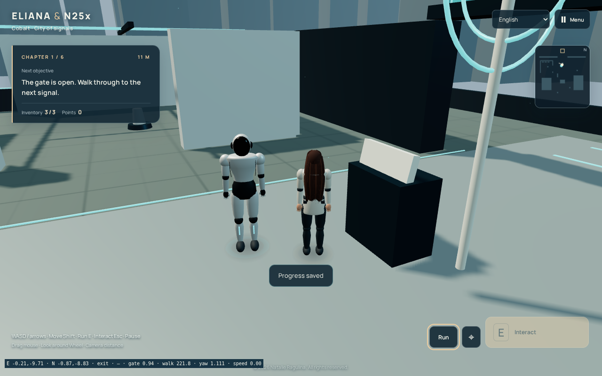
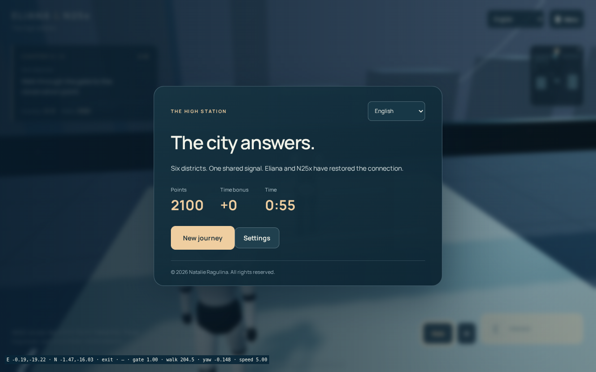
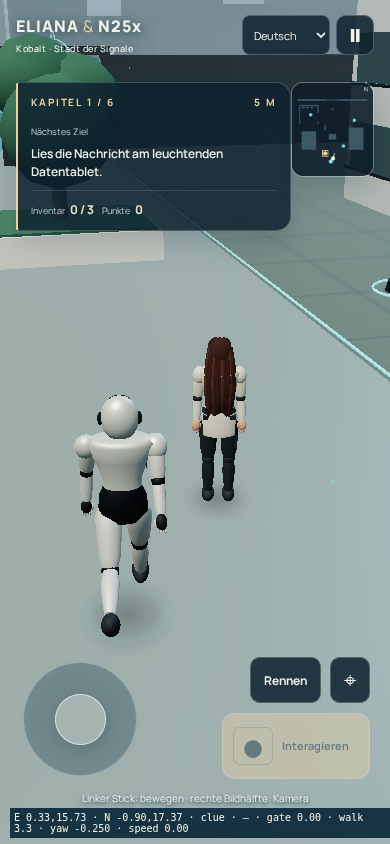
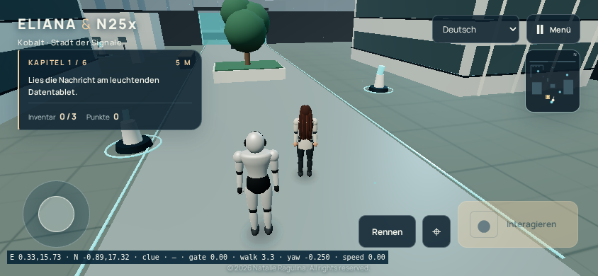

# Eliana & N25x — проверенный 3D-эпизод и прохождение до финала

**© 2026 Natalie Ragulina. Все права защищены.**

Автор концепции и художественного направления — Natalie Ragulina. Разработка и переводы выполнены с помощью ИИ.

[Открыть 3D-игру](https://netaniya.github.io/Netaniya/eliana-n25x/3d/) · [Проверки в GitHub Actions](https://github.com/Netaniya/Netaniya/actions/runs/38883257868) · [Полный отчёт JSON](verification.json) · [Файл продолжения](../../portfolio/eliana-n25x/3d/PROGRESS.ru.md)

В настоящем Chromium с программным WebGL пройдены все шесть миссий посредством клавиатуры и мыши: поиск подсказок, три компонента в каждом районе, прибытие N25x, сканирование, ремонт, физически открывающиеся ворота, переходы и финал с 2100 очками. Тест не телепортирует персонажей и не подменяет состояние задания. Проверены переключение четырёх языков, шаги и настоящий Web Audio, громкость и отключение, пауза, камера и столкновения. После первого района сеть действительно отключена, страница перезагружена, прогресс восстановлен и движение продолжено. Старый ключ сохранения не изменился.

Отдельная проверка Chromium с эмуляцией телефона отправляет два одновременных CDP-касания: джойстик двигает Eliana, другой палец поворачивает камеру. Прокрутки страницы нет. Сделаны реальные снимки при 390×844 и 844×390. Это **эмуляция**, не проверка на физическом Android или iPhone. Фактическая установка приложения и повторное открытие без сети на физических устройствах пока не проверены.

46 автоматических проверок игры включают 31 прежнюю проверку статичного квеста и 15 новых проверок 3D-правил, ввода, навигации, моделей и офлайн-кэша. Отдельно проходят 11 проверок остальных страниц и портфолио. Старые тесты не выдаются за доказательство 3D-управления.

Модели героев — предварительные объёмные модели с суставами и анимацией. Точного портретного сходства и фотореализма не заявляется. Для него нужна соответствующая полнотелая GLB/glTF-модель с текстурами лица, скелетом и разрешёнными анимациями. Все шесть районов пока компактные и используют общий базовый план с различными материалами, оборудованием и задачами.

## Реальные кадры из браузерного прохождения

Техническая строка снизу появляется только при `?qa=1`; обычная ссылка на игру её не показывает. Это снимки работающего рендера, а не концепт-арт.

