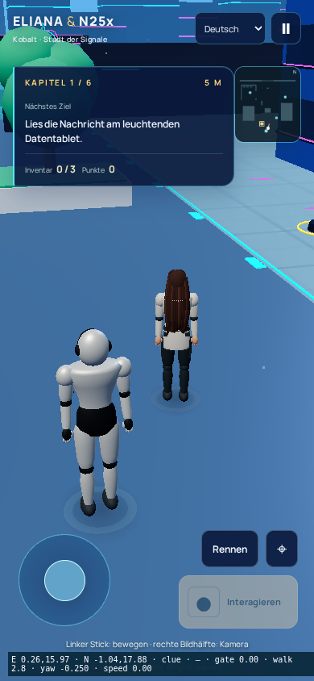
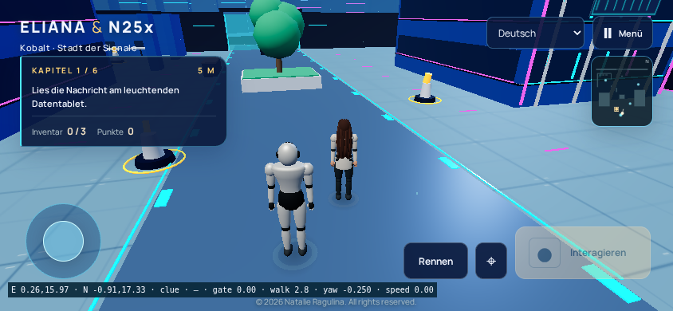

# Яркая технологичная версия Eliana & N25x

© 2026 Natalie Ragulina. Все права защищены.

В обновлении насыщенные палитры шести районов, бирюзовые и фиолетовые линии фасадов, световые полосы небоскрёбов, электронные табло и новая дорожная разметка. Находки выделены золотым. Все изображения панелей и покрытия генерируются программно; новых сторонних материалов или сетевых зависимостей нет. Декоративные полосы объединены в два InstancedMesh. Автор концепции и художественного направления — Natalie Ragulina; разработка с помощью ИИ.

Проверяется сборка `en25x3d-9dbaf6a63d4fed`, исходный коммит `df8f0e6378a1da3f669fc53852ae568b4be1be92`.
[Браузерный прогон](https://github.com/Netaniya/Netaniya/actions/runs/38888174485).

46 проверок игры и 11 проверок портфолио прошли. Прогон двух касаний в эмуляции Chromium прошёл. Настольное прохождение новой сборки пока выполняется. Физические устройства не проверены.

