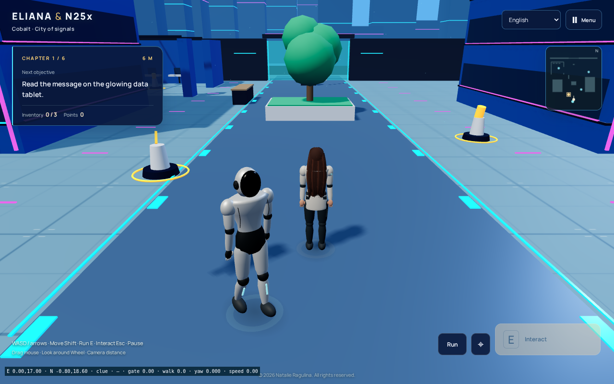
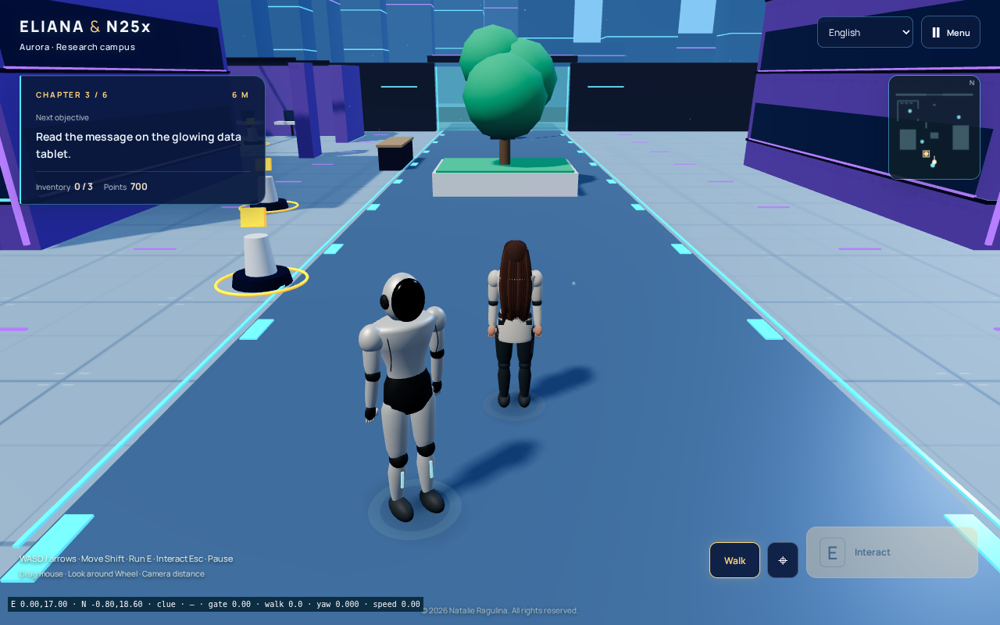
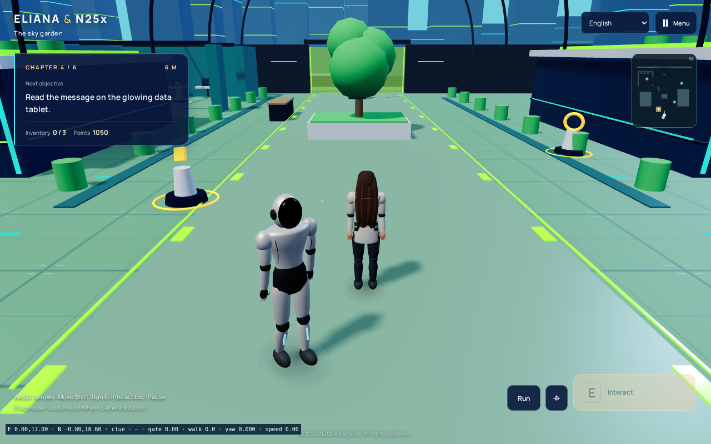
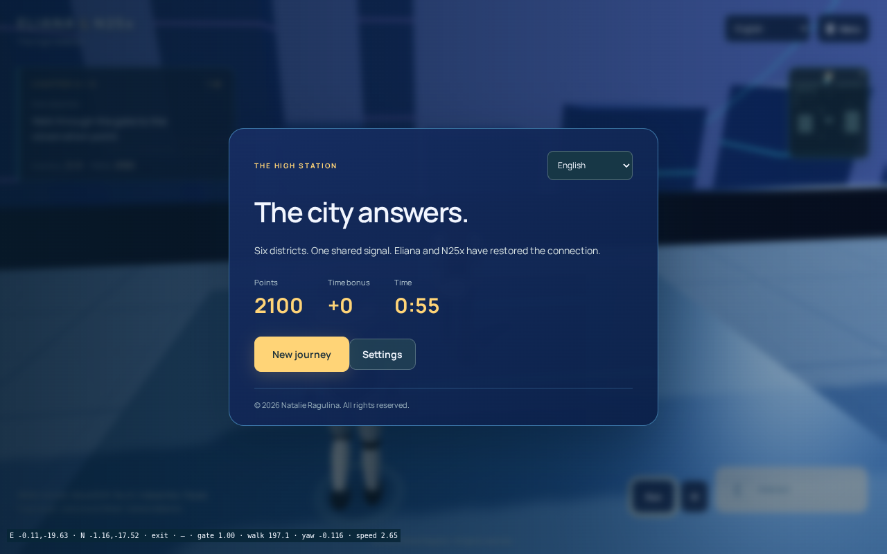

# Яркая технологичная версия Eliana & N25x

**© 2026 Natalie Ragulina. Все права защищены.**

[Открыть игру](https://netaniya.github.io/Netaniya/eliana-n25x/3d/) · [Браузерная проверка](https://github.com/Netaniya/Netaniya/actions/runs/38888174485) · [Отчёт JSON](verification.json)

В обновлении насыщенные палитры шести районов, бирюзовые и фиолетовые линии фасадов, световые полосы небоскрёбов, электронные табло и новая дорожная разметка. Находки выделены золотым. Панели и покрытие генерируются программно; новых сторонних материалов и сетевых зависимостей нет. Декоративные полосы объединены в два InstancedMesh. Автор концепции и художественного направления — Natalie Ragulina; разработка с помощью ИИ.

Проверена сборка `en25x3d-9dbaf6a63d4fed`, исходный коммит `df8f0e6378a1da3f669fc53852ae568b4be1be92`. До успешной проверки она сохранялась в рабочей ветке; опубликованная версия была сохранена.

В настоящем Chromium пройдены все шесть районов посредством клавиатуры и мыши: находки, физическое прибытие N25x, сканирование, ремонт, открытие ворот и финал с 2100 очками. Пройдены движение, бег, анимация, камера, столкновения, четыре языка, звук, пауза и настоящая перезагрузка без сети с восстановлением сохранения. Прогон двух одновременных касаний в эмуляции телефона тоже завершился успешно. Ошибок JavaScript не обнаружено. Снимки ниже получены из работающей игры.

Прошли 46 автоматических проверок игры и 11 проверок портфолио. Схема сохранения, управление и правила заданий не менялись. Физические Android/iOS и фактическая установка PWA на них **не проверены**. Модели остаются предварительными, без заявления о точном портретном сходстве.

## Город

## Кампус и сад

## Финал и эмуляция телефона

